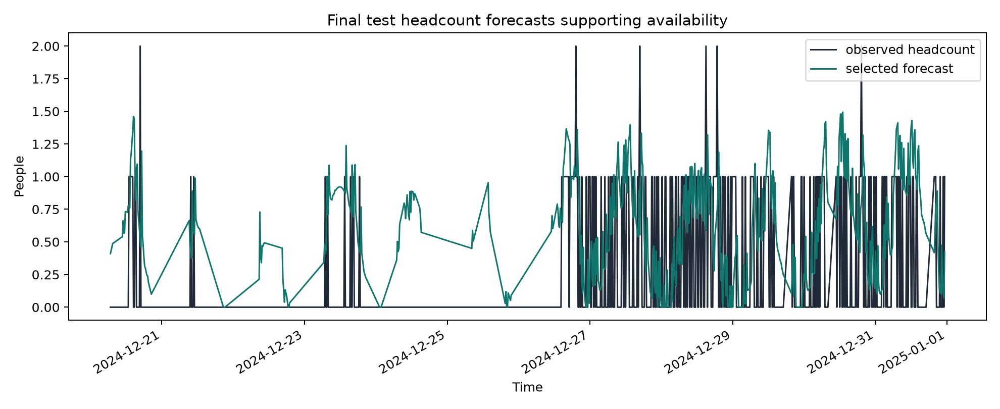
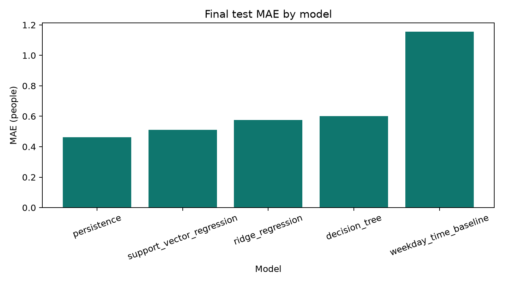
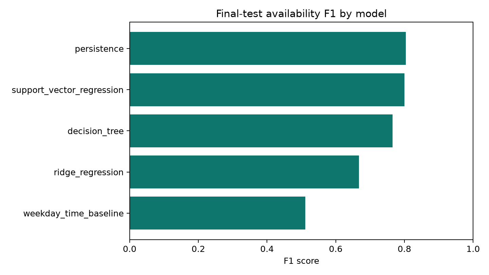
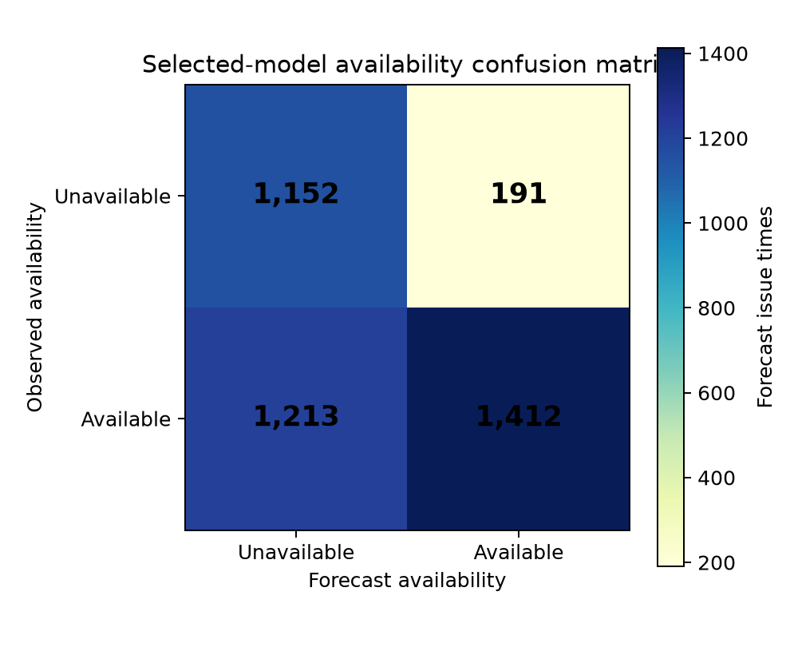

# Final results: G.25 laboratory availability forecasting

This page interprets the reproducible metric files. A laboratory is considered available when its **sensor-derived headcount is 0.5 people or below**. It is an advisory signal, not a confirmed booking or independent sensor audit.

## Main 30-minute headcount forecast result

Ridge regression had the lowest validation MAE (**1.080 people**) and was selected before final testing.

| Final-test model | MAE (people) | RMSE (people) | Bias (people) |
| --- | ---: | ---: | ---: |
| Persistence | **0.461** | 0.944 | 0.009 |
| Support-vector regression | 0.507 | **0.794** | 0.047 |
| Ridge regression | 0.579 | 0.837 | 0.272 |
| Decision tree | 0.591 | 0.911 | 0.225 |
| Weekday/time baseline | 1.168 | 1.589 | 0.969 |

Ridge was selected fairly from validation, but persistence had the lowest final-test MAE. The later period was more stable, so the current observed headcount was a strong predictor. The final operational conclusion is therefore that persistence is the strongest tested 30-minute baseline for this test period, while ridge remains the pre-specified headcount model selected during validation.

## Availability model comparison

All models were converted to the same available/not-available signal using the fixed **0.5-person** rule. SVR had the best validation F1 (75.3%). On the untouched final test, persistence had the strongest F1 (80.4%), narrowly ahead of SVR (80.0%). Ridge remains the pre-selected **headcount** model; final-test availability scores are reported for comparison and are not used to retroactively select a winner.

| Final-test model | Accuracy | Precision | Recall | F1 |
| --- | ---: | ---: | ---: | ---: |
| Persistence | 74.2% | 80.9% | 79.8% | **80.4%** |
| Support-vector regression | 74.0% | 81.4% | 78.6% | 80.0% |
| Decision tree | 71.2% | 83.2% | 70.8% | 76.5% |
| Ridge regression | 64.6% | **88.1%** | 53.8% | 66.8% |
| Weekday/time baseline | 53.0% | 81.9% | 37.2% | 51.1% |

For the selected ridge signal, the final-test confusion matrix contains 1,152 correct unavailable forecasts, 191 **false available** forecasts, 1,213 false unavailable forecasts, and 1,412 correct available forecasts. Its high precision supports cautious advisory use; the missed available periods mean it cannot guarantee access or booking availability.

## Availability-threshold sensitivity

The threshold is a stated operational definition, not a hyperparameter tuned on final-test performance. The project retains **0.5 people** because it distinguishes an empty sensor reading from one or more people. A 1.0-person rule has a higher numerical F1, but it would classify a room with one sensor-derived person as available, which changes the meaning of the service.

| Ridge threshold | Final-test accuracy | Precision | Recall | F1 | Meaning |
| --- | ---: | ---: | ---: | ---: | --- |
| 0.0 people | 41.8% | 93.2% | 13.0% | 22.9% | Strictly zero only |
| **0.5 people** | **64.6%** | 88.1% | 53.8% | 66.8% | Chosen empty-room advisory rule |
| 1.0 people | 76.7% | 97.2% | 76.8% | 85.8% | Treats one person as available |

## Forecast-horizon sensitivity

| Horizon | Best final-test MAE model | Best final-test MAE |
| --- | --- | ---: |
| 15 minutes | Persistence | 0.407 people |
| 30 minutes | Persistence | 0.461 people |
| 60 minutes | Persistence | 0.547 people |

Error rises with forecast horizon, which is expected as uncertainty increases.

## Figures

## How to check the result yourself

1. Read `availability_metrics_validation.csv` before `availability_metrics_final_test.csv`; the former is the development comparison and the latter is final evidence.
2. Confirm `availability_threshold_sensitivity.csv` is an interpretation of a stated threshold, not a final-test model-selection exercise.
3. Confirm the chronological split in `audit.json` and that features use only prior observations.
4. Run the six automated tests. They check software logic, not independently confirmed room occupancy.
5. Report the limits: one room, no manual ground truth, a 21.6-hour outage, no booking-system integration, and no validated environmental-sensor mapping.
